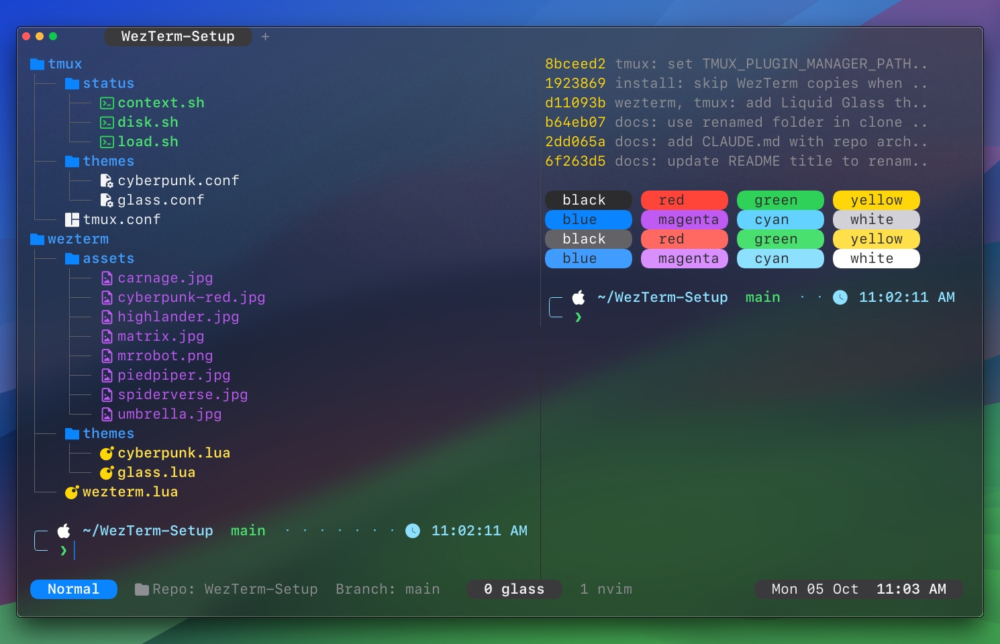

<div align="center">

# WezTerm Setup For MacOS



<br>


A neon macOS terminal setup that installs WezTerm, tmux, fonts, and a privacy-safe status line in one pass.

</div>

## Why This Exists

Fresh laptops should not start with a blank terminal and a pile of forgotten dotfiles.

This repo turns a new Mac into the same terminal environment every time: a polished WezTerm window, a tmux session on launch, readable Nerd Font glyphs, a custom Powerline-style status bar, and screen-share-friendly labels that avoid exposing your real username or hostname.

## What You Get

- Two switchable themes, applied to both WezTerm and tmux:
  - **Liquid Glass** (default) -- a translucent, heavily blurred window that lets the desktop show through, a soft top-edge sheen, Apple dark-mode system colors, SF Mono, floating pill tabs in a different color per tab (the title in its color, the active tab's pill tinted with it), traffic-light buttons drawn right before the first tab (WezTerm's native ones leave a fixed 10-cell gap), and a tmux bar of quiet text plus pills (a mode pill that turns blue/orange/yellow/purple for Normal/Prefix/Copy/Zoom).
  - **Cyberpunk** -- neon cyan/magenta/yellow accents over a rotating pool of cinematic wallpapers. Each new tab picks a random wallpaper from a shuffled queue and keeps it for the tab's lifetime.
- SF Mono is loaded straight from Terminal.app (no install needed); VictorMono Nerd Font for the cyberpunk theme; Symbols Nerd Font fallback for pill caps and Powerline glyphs.
- WezTerm launching straight into tmux so the terminal always has panes, sessions, and status.
- A visible WezTerm `+` tab button: left-click opens a new tab, right-click renames the active tab.
- A custom tmux status line with current mode, repo/directory context, disk space, load, window count, pane count, date, and 12-hour time.
- Privacy-safe screen sharing: no raw username, hostname, or home-folder basename in the tmux status line.
- Newsboat, a terminal RSS reader, preconfigured with a matching neon theme, vim-style keys, and a curated feed list. The Hacker News feed uses the official RSS feed, and tmux tears down unattached sessions so closing a WezTerm tab does not leave Newsboat running in the background.
- A guarded `summarize` wrapper around the `@steipete/summarize` CLI. It resolves Hacker News item links to the source article, blocks Gemini, and limits automatic LLM choices to Claude and Codex.
- A Claude Code completion chime: a Stop hook plays a quiet "Awaiting Orders" clip when Claude finishes a task, instead of reading the response aloud with TTS.
- Claude Code's code in its own panel: the fullscreen renderer (`"tui": "fullscreen"`) with focus view (`"viewMode": "focus"`). The chat shows only your last prompt, a one-line summary of each tool call with its diffstat, and the final answer. The code itself shows in Claude Code's diff panel on the right, which opens when Claude edits a file (or with `/diff`). `/focus` toggles focus view for a session and `Ctrl+O` shows full detail. Claude's pane needs 144+ columns for the diff panel, which the [Claude Tasks Panel](#claude-tasks-panel) leaves free. A "Glass" Claude Code theme (`"theme": "custom:glass"`, the Dark theme with one change) paints the diff panel in palette color 235, which the WezTerm glass theme turns translucent; anywhere else it stays Dark's own grey. `"maxProseWidth": 120` wraps Claude's replies at 120 columns, so they stop short of the panel instead of running into it (Claude Code has no padding setting for the panel).
- A configured zsh shell: a Starship prompt, `eza`-powered `ls`, `zoxide` smart directory jumping, command autosuggestions, and syntax highlighting.
- Neovim with your Lua config — lazy.nvim plugin manager (version-pinned via `lazy-lock.json`), Treesitter, a file tree, and shared `Ctrl-h/j/k/l` navigation with tmux.
- A repeatable installer for setting up another MacBook Pro from scratch.

## Switching Themes

The screenshot at the top shows **Liquid Glass**. **Cyberpunk** layers its neon palette over a rotating pool of darkened wallpapers like this one:


Change one line in each file, then reload (WezTerm reloads on save; tmux with `prefix r`):

- `~/.config/wezterm/wezterm.lua` -- `local THEME = 'glass'` or `'cyberpunk'`
- `~/.tmux.conf` -- `source-file ~/.tmux/themes/glass.conf` or `cyberpunk.conf`

## Install On A Fresh Mac

First install Apple's command line tools:

```sh
xcode-select --install
```

If macOS asks you to accept the license:

```sh
sudo xcodebuild -license accept
```

Then install the setup:

```sh
git clone https://github.com/LawlessNPC/WezTerm-Setup-For-MacOS.git ~/WezTerm-Setup-For-MacOS
cd ~/WezTerm-Setup-For-MacOS
./install.sh
```

Open WezTerm when the installer finishes. New windows and tabs will start inside tmux automatically.

## The Status Line

The tmux bar is built to be useful at a glance without leaking personal machine details.

| Segment | Meaning |
| --- | --- |
| `TMUX` | Static privacy-safe session label |
| `Mode: Normal` | Current tmux mode |
| `Mode: Prefix` | You pressed `Ctrl-a` and tmux is waiting for the next key |
| `Mode: Copy` | tmux copy mode is active |
| `Mode: Zoom` | Current pane is zoomed |
| `Current Dir: Home` | Privacy-safe home directory display |
| `Repo: app  Branch: main` | Git repo context when available |
| `HD 3% 567Gi free` | Root disk usage and remaining space |
| `LOAD 2.25` | 1-minute system load average |
| `Windows: 1  Panes: 2` | tmux window and pane count |
| `Sun 17 May  03:24 PM` | Date and 12-hour time |

## Keyboard Flow

Prefix key:

```text
Ctrl-a
```

Common bindings:

| Keys | Action |
| --- | --- |
| `Ctrl-a |` | Split pane horizontally |
| `Ctrl-a -` | Split pane vertically |
| `Ctrl-a h/j/k/l` | Resize panes |
| `Ctrl-a m` | Zoom current pane |
| `Ctrl-a r` | Reload `~/.tmux.conf` |
| `v` in copy mode | Start selection |
| `y` in copy mode | Copy selection to the macOS clipboard |
| Mouse drag | Select and copy straight to the macOS clipboard |

## WezTerm Tab Controls

The WezTerm tab bar always stays visible and includes the `+` tab button.

| Action | Result |
| --- | --- |
| Left-click `+` | Open a new tmux-backed WezTerm tab |
| Right-click `+` | Prompt to rename the active WezTerm tab |
| Submit a blank tab name | Reset the active tab title |

## Summarize Guard

`install.sh` installs the `summarize` wrapper to `~/.local/bin/summarize`, prepends `~/.local/bin` to your `PATH` in `~/.zprofile`, and installs the upstream `@steipete/summarize` CLI, or upgrades it to the latest npm release on every re-run.

It keeps the upstream `@steipete/summarize` CLI available while adding local policy:

- Hacker News item URLs such as `https://news.ycombinator.com/item?id=...` are resolved to the linked story before summarizing.
- Gemini CLI/API usage is refused, even if a command explicitly passes a Gemini model.
- Auto model selection uses only `cli/claude/opus` and `cli/codex/gpt-5.2`.
- Summaries are asked for as 2 to 4 markdown sections with bullets at `medium` length, which keeps the themed renderer's spacing readable. Pass your own `--prompt` or `--length` to override. Very short pages are still returned as extracted text.

The wrapper runs the real `@steipete/summarize` binary found via `SUMMARIZE_REAL_BIN`, or `/usr/local/bin/summarize` by default. When the CLI installs elsewhere (such as Homebrew's `/opt/homebrew/bin`), `install.sh` writes the correct `SUMMARIZE_REAL_BIN` into `~/.zprofile` automatically.

## Claude Tasks Panel

A panel docked to each Claude Code pane that lists its background shells and subagents: how long each has run, when it started or finished (12-hour clock), its last line of output, what each subagent is doing right now (`Read: main.gd`, `WebFetch: …`, `thinking…`) and its agent type, and for builds and tests a bar with **% left and an ETA**. The estimate is the median of the last five successful runs of the same command (`make check`, `make test-watch`, …), measured from Claude's own task files. A command with no history shows elapsed time only.

It has two shapes and switches between them by itself:

- **Idle strip**: a 5-row strip along the bottom of the Claude pane, opened when a Claude session starts (a `SessionStart` hook runs `claude-tasks --session-start`). It shows the two most recent tasks beside their sprites, or four, one line each, with sprites off.
- **Full panel**: when a background shell or subagent starts, the strip widens into the full panel (a `PostToolUse` hook, `claude-tasks --hook`, also opens it if the tab has no panel). About 8 seconds after nothing runs, it shrinks back to the strip.
- **Keeps Claude Code's diff panel working**: Claude Code shows its diff panel (`/diff`) only when its pane is at least 144 columns wide. The strip takes rows, never columns, and the full panel goes on the right only when Claude keeps 150+ columns. On a narrower window it opens taller along the bottom instead.
- **One per tab, focused on its session**: the panel follows the Claude session that opened it (`a` toggles every session), and it closes when that Claude pane closes. Inside tmux, the hooks find the right WezTerm pane through the tmux client's tty, not `$WEZTERM_PANE` (which tmux leaves pointing at whichever pane started the tmux server).
- **`Cmd+Shift+B`** opens it by hand, with the same width rule. That copy stays open until you press `q`.
- **A Pokémon per task**: each task gets a random Gen 3 party-menu icon, picked from its id, so it keeps the same one across redraws and restarts. It bobs while the task runs and stands still once it ends, as the game shows a fainted Pokémon. In the last 3 seconds before a finished task leaves the list, it returns to its Poké Ball: it flashes, turns red and shrinks into the open ball, which closes and wobbles. The icons are drawn with the iTerm2 image protocol at a whole-number scale that fits two rows. They show only in WezTerm. To turn them off, add `export CLAUDE_TASKS_SPRITES=0` to `~/.zshrc` (the panel inherits Claude's environment).
- **Sprite cache**: icons and the Poké Ball are fetched from [pret/pokeemerald](https://github.com/pret/pokeemerald) (a pinned commit) on first use into `~/.cache/claude-tasks/sprites/`. They are never stored in this repo.

| Key | Does |
| --- | --- |
| `j` / `k` | Move the selection |
| `x` | Kill the selected shell (asks `y/n`; agents are stopped from Claude) |
| `d` | Clear stale rows: tasks whose shell died without finishing |
| `a` | Switch between this session and every session |
| `q` | Close the panel |

Finished tasks stay listed for 3 minutes. Long foreground commands (5 seconds or more) show too, marked `foreground`, but don't widen the strip. `claude-tasks --list` prints the same thing once, for debugging. The tests are in `wezterm/bin/test_claude_tasks.py` (`python3 -m unittest wezterm/bin/test_claude_tasks.py`).

## Installed Pieces

Homebrew installs:

```text
git
micro
neovim
newsboat
node
tmux
fastfetch
eza
starship
zoxide
wezterm
font-victor-mono-nerd-font
font-symbols-only-nerd-font
```

Config installed:

```text
~/.config/wezterm/wezterm.lua
~/.config/wezterm/assets/  (full wallpaper pool)
~/.config/wezterm/themes/  (glass.lua, cyberpunk.lua)
~/.config/wezterm/bin/claude-tasks
~/.tmux.conf
~/.tmux/themes/           (glass.conf, cyberpunk.conf)
~/.tmux/status/context.sh
~/.tmux/status/disk.sh
~/.tmux/status/load.sh
~/.config/newsboat/config
~/.config/newsboat/urls
~/.local/bin/summarize
~/.summarize/config.json
~/.zshrc
~/.config/starship.toml
~/.config/micro/bindings.json
~/.config/nvim/
~/.claude/themes/glass.json
```

`install.sh` also appends (never overwrites) to `~/.zprofile`, putting `~/.local/bin` on `PATH` for the `summarize` wrapper.

tmux plugins are managed by TPM, and `zsh-autosuggestions` / `zsh-syntax-highlighting` are cloned into `~/.zsh/`. The installer handles all of them.

## Repository Layout

```text
.
|-- Brewfile
|-- docs
|   `-- screenshots
|       `-- glass.jpg
|-- install.sh
|-- micro
|   `-- bindings.json
|-- newsboat
|   |-- config
|   `-- urls
|-- nvim
|   |-- init.lua
|   |-- lazy-lock.json
|   `-- lua
|-- summarize
|   |-- config.json
|   `-- summarize
|-- tmux
|   |-- tmux.conf
|   |-- themes
|   |   |-- glass.conf
|   |   `-- cyberpunk.conf
|   `-- status
|       |-- context.sh
|       |-- disk.sh
|       `-- load.sh
|-- wezterm
|   |-- wezterm.lua
|   |-- bin
|   |   |-- claude-tasks
|   |   `-- test_claude_tasks.py
|   |-- themes
|   |   |-- glass.lua
|   |   `-- cyberpunk.lua
|   `-- assets
|       |-- carnage.jpg
|       |-- cyberpunk-red.jpg
|       |-- highlander.jpg
|       |-- matrix.jpg
|       |-- mrrobot.png
|       |-- piedpiper.jpg
|       |-- spiderverse.jpg
|       `-- umbrella.jpg
`-- zsh
    |-- starship.toml
    `-- zshrc
```

## Manual Install

Use this if you want to copy the config files yourself:

```sh
mkdir -p ~/.config/wezterm/assets ~/.config/wezterm/themes ~/.tmux/themes ~/.config/newsboat ~/.config/micro ~/.config/nvim ~/.tmux/status ~/.local/bin ~/.summarize ~/.zsh
cp wezterm/wezterm.lua ~/.config/wezterm/wezterm.lua
cp wezterm/themes/*.lua ~/.config/wezterm/themes/
mkdir -p ~/.config/wezterm/bin && cp wezterm/bin/claude-tasks ~/.config/wezterm/bin/ && chmod +x ~/.config/wezterm/bin/claude-tasks
cp -R wezterm/assets/. ~/.config/wezterm/assets/
cp tmux/tmux.conf ~/.tmux.conf
cp tmux/themes/*.conf ~/.tmux/themes/
cp tmux/status/*.sh ~/.tmux/status/
chmod +x ~/.tmux/status/*.sh
cp newsboat/config ~/.config/newsboat/config
cp newsboat/urls ~/.config/newsboat/urls
cp summarize/summarize ~/.local/bin/summarize
chmod +x ~/.local/bin/summarize
cp summarize/config.json ~/.summarize/config.json
cp zsh/zshrc ~/.zshrc
cp zsh/starship.toml ~/.config/starship.toml
cp micro/bindings.json ~/.config/micro/bindings.json
cp -R nvim/. ~/.config/nvim/
mkdir -p ~/.claude/themes && cp claude/themes/glass.json ~/.claude/themes/  # then set "theme": "custom:glass" and "maxProseWidth": 120 in ~/.claude/settings.json
echo 'export PATH="$HOME/.local/bin:$PATH"' >> ~/.zprofile
npm install -g @steipete/summarize@latest
```

Install the shell and tmux plugins:

```sh
git clone https://github.com/zsh-users/zsh-autosuggestions ~/.zsh/zsh-autosuggestions
git clone https://github.com/zsh-users/zsh-syntax-highlighting ~/.zsh/zsh-syntax-highlighting
git clone https://github.com/tmux-plugins/tpm ~/.tmux/plugins/tpm
~/.tmux/plugins/tpm/bin/install_plugins
```

## Troubleshooting

### Git or Homebrew says the Xcode license is not accepted

Run:

```sh
sudo xcodebuild -license accept
```

### Powerline arrows look broken

Make sure the Nerd Font casks installed successfully, then restart WezTerm:

```sh
brew install --cask font-victor-mono-nerd-font font-symbols-only-nerd-font
```

### WezTerm opens but tmux does not start

Check that tmux is installed:

```sh
command -v tmux
```

If it is missing:

```sh
brew install tmux
```

### Newsboat says another instance is already running

This setup sets `destroy-unattached on` in tmux. Reload the config in any active tmux session:

```sh
tmux source-file ~/.tmux.conf
```

After that, closing a WezTerm tab should destroy its tmux session and stop foreground programs like Newsboat.

### `summarize` tries to use Gemini

The wrapper blocks Gemini at the command level and the config removes Gemini from auto selection. Check that the wrapper is first in `PATH`:

```sh
which -a summarize
```

The first result should be:

```text
~/.local/bin/summarize
```

## Keep This Backup Updated

After changing your local WezTerm or tmux setup, copy the updated files into this repo and push:

```sh
cd ~/WezTerm-Setup-For-MacOS
git add .
git commit -m "Update terminal setup"
git push
```
